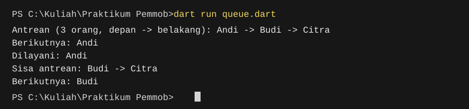

# Program Queue

## Identitas

- Nama: Muhammad Inas Pratama
- NIM: H1D024063
- Shift KRS: A
- Shift Praktikum: D

## Penjelasan kode

Program ini menerapkan struktur data antrean (*queue*) dengan aturan FIFO (*First In, First Out*): data yang masuk lebih dahulu akan dilayani lebih dahulu.

Class `Queue<T>` bersifat generik, sehingga dapat menyimpan berbagai tipe data. Contoh pada `main()` menggunakan `Queue<String>` untuk menyimpan nama orang.

- `_items` menyimpan seluruh elemen antrean, sedangkan `_head` menunjuk elemen paling depan yang belum dilayani.
- `enqueue(value)` menambahkan elemen ke bagian belakang antrean.
- `dequeue()` mengambil dan menghapus elemen paling depan. Jika antrean kosong, method ini melempar `StateError`.
- `peek()` melihat elemen paling depan tanpa menghapusnya.
- `length`, `isEmpty`, dan `isNotEmpty` memberikan informasi tentang keadaan antrean.
- `toList()` menampilkan salinan yang tidak dapat diubah dari elemen yang masih menunggu, mulai dari depan ke belakang.
- `clear()` mengosongkan antrean. Elemen lama juga dirapikan secara otomatis setelah cukup banyak elemen dilayani.

Pada contoh, Andi, Budi, lalu Citra masuk ke antrean. Andi berada di depan sehingga dilayani terlebih dahulu; setelah itu Budi menjadi orang berikutnya.

## Menjalankan program

Jalankan perintah berikut dari folder proyek:

```bash
dart run queue.dart
```

## Screenshot output



Output terminal:

```text
Antrean (3 orang, depan -> belakang): Andi -> Budi -> Citra
Berikutnya: Andi
Dilayani: Andi
Sisa antrean: Budi -> Citra
Berikutnya: Budi
```